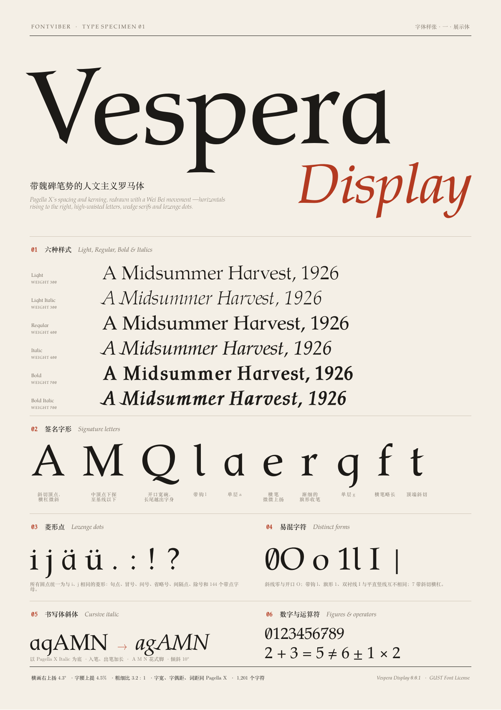
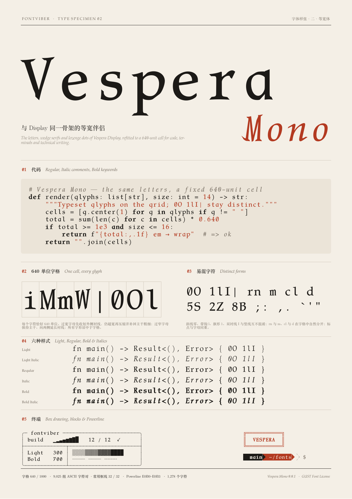
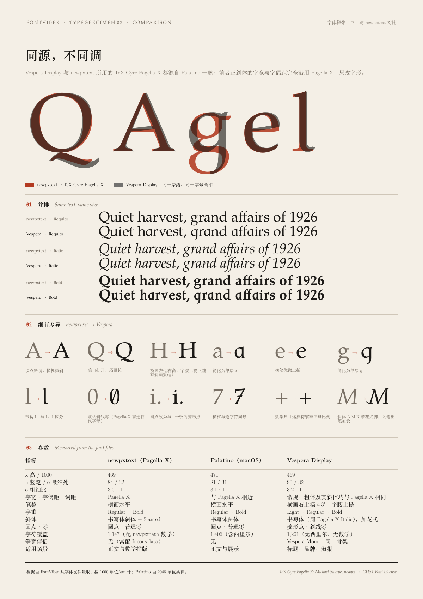
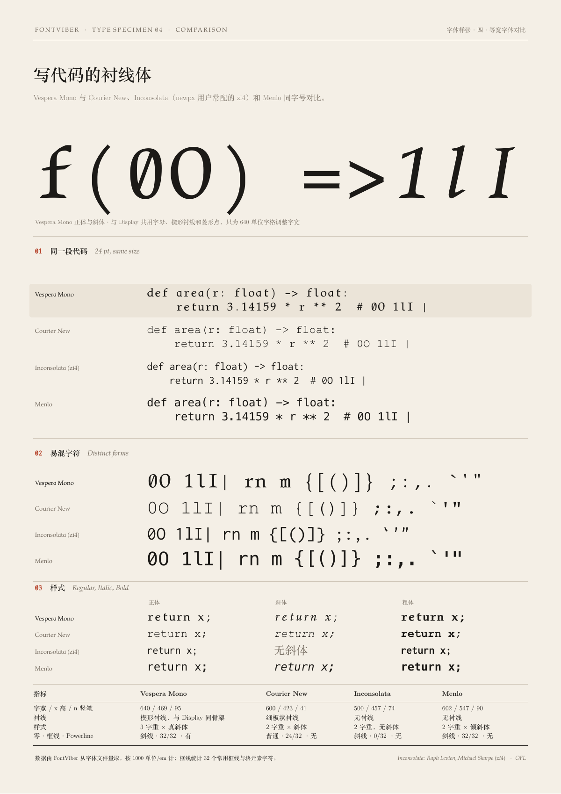

# Vespera 长庚 — Display & Mono

English | [简体中文](README.zh-CN.md)

A humanist roman with a Wei Bei (Northern Wei stele) movement, derived from TeX Gyre Pagella, in two families: the proportional **Vespera Display** and the monospaced **Vespera Mono**. Both share one set of letter drawings; Mono only adapts widths and spacing.

The Chinese name is **长庚** (Chánggēng, the evening star). *Vespera* is Latin for evening, akin to *Vesper*, the evening star (Venus seen in the western sky at dusk); like *Pagella* (Latin for "little page"), the name keeps to Latin.

<table>
<tr>
<td width="50%"><a href="docs/images/display.png"></a></td>
<td width="50%"><a href="docs/images/mono.png"></a></td>
</tr>
<tr>
<td width="50%"><a href="docs/images/compare-display.png"></a></td>
<td width="50%"><a href="docs/images/compare-mono.png"></a></td>
</tr>
</table>

The specimens are annotated in Chinese.

## Features

- **Wei Bei movement**: horizontals rise about 4.3° to the right and the waist is lifted 4.5%; every stroke end is cut like a carving, together with wedge serifs and lozenge dots.
- **Pagella X spacing**: the Regular, Italic, Bold and Bold Italic of Display have the same advances and kerning as the matching TeX Gyre Pagella X fonts used by newpxtext, so they can replace them without changing line lengths.
- **Simplified letters**: the roman uses single-storey a and g; the italic is based on the Pagella X Italic cursive, with longer entry and exit strokes and swash feet on A, M and N.
- **Three weights, roman and italic**: Light (300), Regular (400) and Bold (700), each with an italic.
- **Mono for code and terminals**: every glyph is 640 units wide, confusable characters (0/O, 1/l/I) are clearly distinct, and box drawing, block elements and Powerline separators are complete.

| Family | Glyphs | Characters |
| --- | --- | --- |
| Vespera Display | 1,551 | 1,201 |
| Vespera Mono | 1,628 | 1,278 |

## Download and use

Download `Vespera-<version>.zip` from GitHub Releases. It holds three formats:

- **`otc/`**: one collection file per family; install it once to get all six styles. Works on macOS, Windows 10 and later, XeLaTeX / LuaLaTeX and common desktop applications.
- **`otf/`**: one file per style, for applications that do not support collections.
- **`woff2/`**: for the web. Declare each style with `@font-face`, using `font-weight: 300 | 400 | 700` and `font-style: normal | italic`.

After installing, choose Vespera Display or Vespera Mono in your application. For Mono, start at 14–18 px. Both families cover Latin (including extended Latin) only, with no Chinese; the outlines carry no screen hinting.

## Build from source

You need Python 3.9 or later and the FreeType, HarfBuzz and Brotli native libraries; no pip packages. The build has been verified on macOS only.

```bash
brew install freetype harfbuzz brotli
```

Build every style of both families (about 15 seconds) into `output/fonts/`:

```bash
python3 build.py build
```

Rebuild from the sources and compare byte for byte with the existing fonts (the output files are not changed):

```bash
python3 build.py check
```

Everything the build reads is in the repository:

- [`sources/`](sources/README.md): text sources of TeX Gyre Pagella Regular and Italic (one file per font), and spacing parameters extracted from Pagella X.
- [`configs/`](configs/): the build configuration of each family (family name, version, styles, output formats).
- [`fontviber/`](fontviber/): the design and build code, using only the Python standard library.

## Releases

Publishing a GitHub Release tagged `v<version>` (for example `v0.0.1`) runs the [release workflow](.github/workflows/release.yml), which:

1. checks that the tag matches `version` in `configs/*.json`;
2. rebuilds and validates every font from the sources;
3. uploads the zip, the two OTC collections and `SHA256SUMS.txt` to that release.

Before releasing a new version, change `version` in both configuration files and commit.

## License

Vespera is a modified version of TeX Gyre Pagella, distributed under the [GUST Font License](licenses/GUST-FONT-LICENSE.txt) (based on [LPPL 1.3c](licenses/lppl.txt)). For the original authors and copyright, see the [Pagella notes](licenses/README-TeX-Gyre-Pagella.txt); for the modifications and the list of files, see [MANIFEST-Vespera.txt](MANIFEST-Vespera.txt).
