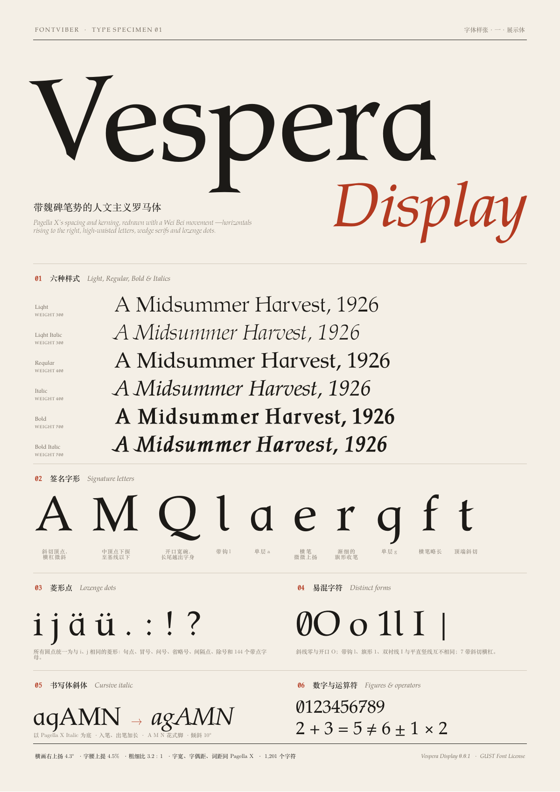
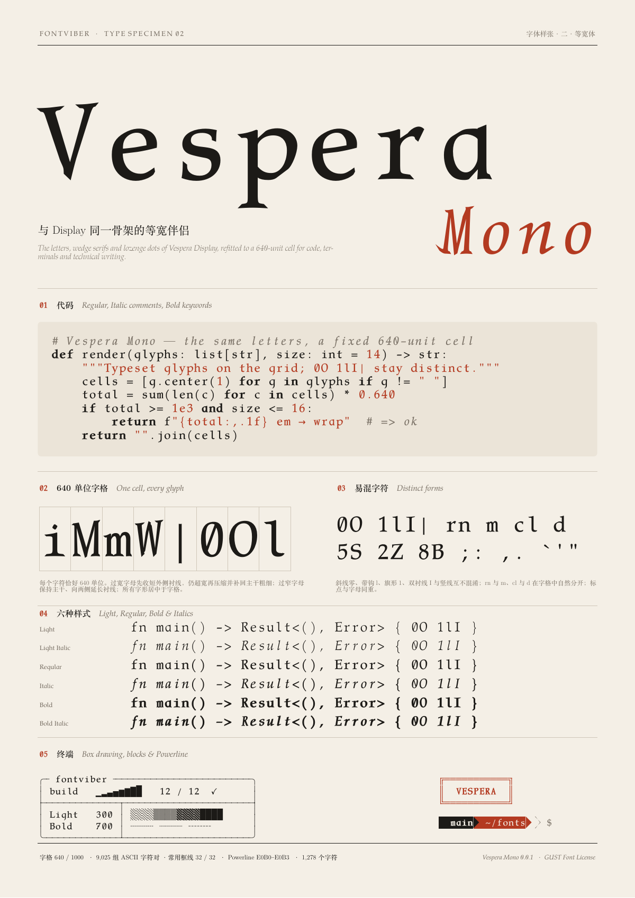
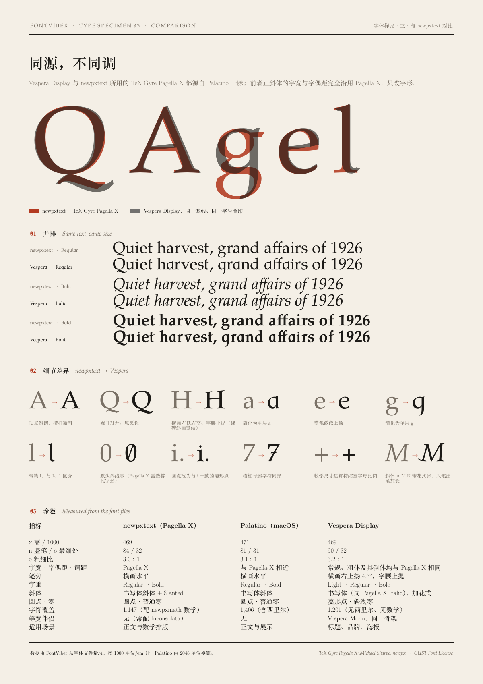
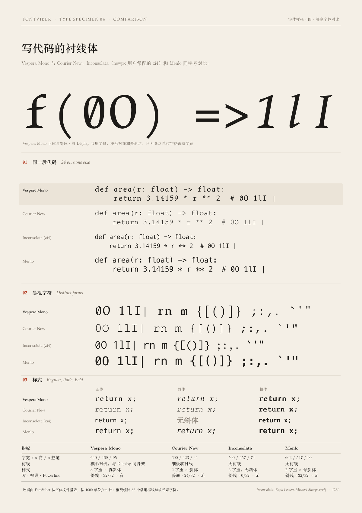

# Vespera 长庚 — Display & Mono

[English](README.md) | 简体中文

带魏碑笔势的人文主义罗马体，由 TeX Gyre Pagella 衍生，分为比例字族 **Vespera Display** 与等宽字族 **Vespera Mono**。两者共用同一套字形设计，Mono 只调整字宽与间距。

中文名**长庚**。Vespera 是拉丁语的「黄昏」，与 Vesper（长庚星，即黄昏时出现在西方天空的金星）同源；母本 Pagella 也是拉丁词（「小页面」），这里沿用拉丁语命名。

<table>
<tr>
<td width="50%"><a href="docs/images/display.png"></a></td>
<td width="50%"><a href="docs/images/mono.png"></a></td>
</tr>
<tr>
<td width="50%"><a href="docs/images/compare-display.png"></a></td>
<td width="50%"><a href="docs/images/compare-mono.png"></a></td>
</tr>
</table>

## 特点

- **魏碑笔势**：横画向右上扬约 4.3°，字腰上提 4.5%；笔画末端统一按刀刻斜切，配合楔形衬线与菱形点。
- **间距同 Pagella X**：Display 的常规、斜体、粗体和粗斜体，字宽与字偶距分别与 newpxtext 所用的 TeX Gyre Pagella X 对应字体相同，可直接替换而不改变排版长度。
- **简化字母**：正体采用单层 a、g；斜体以 Pagella X Italic 的书写体为底，入笔和出笔加长，A、M、N 带花式脚。
- **三种字重 × 正斜体**：Light（300）、Regular（400）、Bold（700），每种都有正体和斜体。
- **Mono 适合代码与终端**：字宽统一 640 单位，易混字符（0/O、1/l/I）区分明确；128 个制表符、32 个块元素和 Powerline 分隔符全部按字格绘制；罗马尼亚语文本仍会使用下加逗号的 ș、ț。

| 字族 | 字形 | 字符 |
| --- | --- | --- |
| Vespera Display | 1,551 | 1,201 |
| Vespera Mono | 1,699 | 1,349 |

## 下载与使用

在 GitHub Releases 下载 `Vespera-<版本>.zip`，里面有三种格式：

- **`otc/`**：每个字族一个合集文件，安装一次即可得到全部 6 个样式。适用于 macOS、Windows 10 及以上、XeLaTeX / LuaLaTeX 和常见桌面软件。
- **`otf/`**：每个样式一个文件，供不支持合集的软件使用。
- **`woff2/`**：网页用。用 `@font-face` 为每个样式分别指定 `font-weight: 300 | 400 | 700` 和 `font-style: normal | italic`。

安装后，在软件中选择 Vespera Display 或 Vespera Mono 即可。Mono 建议从 14–18 px 开始试排。两种字体只覆盖拉丁字母（含扩展），不含中文；轮廓没有加屏幕 hinting。

## 从源码构建

需要 Python 3.9 及以上版本，以及 FreeType、HarfBuzz、Brotli 原生库；不需要 pip 包。目前只在 macOS 上验证过。

```bash
brew install freetype harfbuzz brotli
```

生成两种字族的全部样式（约 15 秒），输出到 `output/fonts/`：

```bash
python3 build.py build
```

从源文件重建，并与现有字体逐字节比对（不修改输出文件）：

```bash
python3 build.py check
```

构建的输入都在仓库里：

- [`sources/`](sources/README.zh-CN.md)：TeX Gyre Pagella 正体和斜体的文本源文件（每份字体一个文件），以及从 Pagella X 提取的间距参数。
- [`configs/`](configs/)：两个字族的构建配置（字族名、版本、样式、输出格式）。
- [`fontviber/`](fontviber/)：设计与构建代码，只用 Python 标准库。

## 发布

在 GitHub 上以 `v<版本>` 为标签发布 Release（例如 `v0.0.1`），[release 工作流](.github/workflows/release.yml)会自动完成以下步骤：

1. 检查标签与 `configs/*.json` 中的 `version` 是否一致；
2. 从源文件重建并校验全部字体；
3. 把 zip 包、两个 OTC 合集和 `SHA256SUMS.txt` 上传到这个 Release。

发布新版本前，先修改两个配置文件中的 `version` 并提交。

## 许可

Vespera 是 TeX Gyre Pagella 的修改版本，按 [GUST Font License](licenses/GUST-FONT-LICENSE.txt)（基于 [LPPL 1.3c](licenses/lppl.txt)）分发。原作者与版权信息见 [Pagella 说明](licenses/README-TeX-Gyre-Pagella.txt)；修改内容和文件清单见 [MANIFEST-Vespera.txt](MANIFEST-Vespera.txt)。
